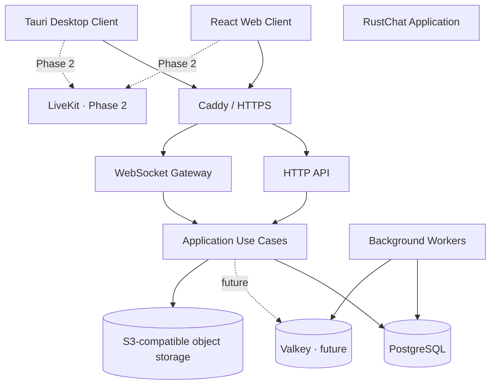

# RustChat Architecture

## 1. Purpose and status

This document describes the intended high-level architecture and current implementation of RustChat. Phase 0 is complete. Phase 1 implementation includes identity, editable profiles and privacy-scoped presence, authenticated password change, account lifecycle, PostgreSQL-shared authentication rate limits, conversations, communities, channels and permissions, durable messaging, emoji reactions, read and delivery cursors, WebSocket delivery (shared across server instances) for messages, presence, typing, reactions, delivery cursors, and community-scoped member/channel invalidations, plus the initial web client and instance administration. Phase 2 has begun with an initial attachment upload, message association and authorized-download path backed by an optional S3-compatible adapter. Screen-reader review remains outstanding; object-store deployment and recovery have not been validated. Later sections distinguish implemented components from planned architecture; verify details against the code and API documentation.

RustChat is a self-hostable real-time communication platform with a Rust backend and a shared React frontend for web and desktop.

## 2. Architectural goals

- Clear separation of business rules, application workflows and infrastructure.
- Security enforced at trusted backend boundaries.
- Reliable message persistence and realtime delivery.
- Self-hosting with no mandatory paid SaaS dependency.
- Efficient memory, CPU, database and network usage.
- Testable modules and explicit communication contracts.
- A path to horizontal scaling without premature distributed-system complexity.

## 3. High-level system



The RustChat application initially runs as a modular monolith. HTTP handling, WebSocket handling, application services and background workers may be separate runtime tasks or processes, but they share one codebase and domain model.

## 4. Technology choices

| Area | Current choice / status |
|---|---|
| Backend language | Rust |
| Async runtime | Tokio |
| HTTP framework | Axum |
| Database access | SQLx |
| Primary database | PostgreSQL |
| Cache / ephemeral coordination | Authentication rate limits use shared PostgreSQL storage; WebSocket fan-out, outbox dispatch and presence are coordinated through PostgreSQL (`LISTEN/NOTIFY`, row leases and a presence table), so several server instances can share one database. Valkey is present in local development but unused by the application |
| Realtime client transport | WebSocket |
| Web frontend | React + TypeScript + Vite |
| Desktop wrapper | Tauri 2 |
| UI styling | CSS |
| Server state | React component state and fetch |
| Local UI state | React component state |
| Object storage | Optional S3-compatible storage behind an application port; AWS Rust SDK adapter implemented, Garage selected but not bundled |
| Voice/media | Self-hosted LiveKit, planned for Phase 2 |
| Reverse proxy | Caddy |
| Deployment | Docker Engine + Docker Compose |

The current implementation uses the choices marked current. Services and libraries marked planned are not implemented dependencies; review compatibility, security, maintenance and licences before adopting them.

## 5. Backend architecture

Use Clean Architecture and domain-oriented modules.

```text
backend/
├── apps/
│   └── server/
│       └── src/
│           ├── main.rs
│           ├── bootstrap.rs
│           ├── config.rs
│           └── shutdown.rs
├── crates/
│   ├── domain/
│   │   ├── identity/
│   │   ├── messaging/
│   │   ├── conversations/
│   │   ├── communities/
│   │   ├── channels/
│   │   ├── permissions/
│   │   ├── attachments/
│   │   └── voice/
│   ├── application/
│   ├── infrastructure/
│   │   ├── postgres/
│   │   ├── valkey/
│   │   ├── object_storage/
│   │   ├── event_delivery/
│   │   └── livekit/
│   ├── interfaces/
│   │   ├── http/
│   │   ├── websocket/
│   │   └── protocol/
│   └── shared/
├── migrations/
└── tests/
```

**Current state:** the workspace has `crates/domain`, `crates/application`, `crates/infrastructure` and `crates/http` (the HTTP part of `interfaces`), plus `apps/server` for bootstrap. Identity, editable basic profiles and privacy-scoped presence, authenticated password change, conversations, communities, channels, roles and permissions, plain-text message persistence with same-conversation replies, member mentions and reactions, read and delivery cursors, and multi-instance WebSocket message, presence, typing, reaction and delivery-ack delivery are implemented. Fan-out across instances uses PostgreSQL (ADR 0014); a Valkey adapter is not implemented. Domain modules are flat files until there is enough code to justify the per-area directories shown above. `crates/websocket`, `protocol` and `shared` have not been created.

### Dependency rules

1. Domain contains entities, value objects, invariants and domain rules. It must not depend on Axum, SQLx, Valkey or LiveKit.
2. Application coordinates use cases and defines ports/interfaces required from external systems.
3. Infrastructure implements those ports using databases, caches, storage and external protocols.
4. Interface adapters translate HTTP and WebSocket input/output to application operations.
5. Bootstrap constructs and wires concrete implementations.

Keep boundaries useful and enforceable. Do not create abstractions without a clear reason.

## 6. Frontend architecture

Use one shared React + TypeScript application for web and desktop.

```text
frontend/
├── apps/
│   ├── web/
│   │   └── src/
│   │       ├── app/
│   │       ├── layouts/
│   │       ├── routes/
│   │       └── styles/
│   └── desktop/
│       └── src-tauri/
└── packages/
    ├── ui/
    ├── features/
    │   ├── auth/
    │   ├── messaging/
    │   ├── conversations/
    │   ├── communities/
    │   ├── channels/
    │   ├── attachments/
    │   ├── voice/
    │   └── settings/
    ├── api-client/
    ├── realtime-client/
    ├── crypto/
    ├── state/
    ├── shared/
    └── test-utils/
```

Create feature modules as they are implemented; avoid empty placeholder packages.

**Current state:** a single app, `frontend/apps/web/src`, organised by feature rather than the package layout above:

```text
src/
├── App.tsx              application shell: session lifecycle and layout
├── types.ts             API resource types
├── lib/                 API client, ids, formatting, permission bits, theme
├── components/          shared UI (accessible modal Dialog)
└── features/
    ├── auth/            sign-in, registration, password recovery
    ├── account/         profile, security, privacy, account actions, instance admin
    ├── conversations/   conversation list, new-conversation dialog
    ├── messages/        message list/composer, Markdown rendering, conversation state
    ├── communities/     community/channel sidebar, dialogs, management dialog (lazy loaded)
    └── realtime/        WebSocket connection and event routing
```

### Current frontend state boundaries

- React component state and `fetch`: remote data and local UI state. A feature keeps its own form state in its component; shared server state lives in hooks (`useConversation`, `useCommunities`).
- `features/realtime/useRealtime.ts`: WebSocket lifecycle, incoming event handling and reconnect synchronization.
- TanStack Query, Zustand and Zod are not current dependencies; consider them only if the frontend's needs justify their adoption.

The frontend is not a security boundary. The backend must independently validate and authorize every operation.

## 7. Communication model

- REST/HTTP for resource operations, queries and commands.
- WebSockets for server-pushed events and realtime interaction.
- Direct client-to-object-storage uploads using short-lived authorization where supported.
- WebRTC clients connect to LiveKit for voice media; RustChat authorizes room access.

The detailed contracts belong in `API_AND_REALTIME.md`.

## 8. Reliable messaging

A message send should follow this conceptual sequence:

1. Client creates a UUIDv7 client message identifier.
2. Server authenticates the sender and checks conversation access.
3. Server validates the request and idempotency key.
4. A database transaction allocates a conversation sequence, inserts the message and inserts an outbox event.
5. A worker publishes committed outbox events.
6. Realtime infrastructure distributes events to connected gateways.
7. Gateways deliver events to authorized clients.
8. Clients deduplicate events and synchronize from their last acknowledged cursor after reconnecting.

Use at-least-once delivery with idempotent processing. Do not claim exactly-once network delivery.

Each server instance claims pending PostgreSQL outbox rows with a short lease, publishes them through bounded Tokio broadcast channels to the clients connected to it, and shares events with the other instances through PostgreSQL `LISTEN/NOTIFY` (see [ADR 0014](adr/0014-multi-instance-realtime-through-postgresql.md)). Notifications are hints, not storage: PostgreSQL history and the outbox remain the recovery source, and a client that may have missed events is told to reconnect and resynchronize. Valkey Pub/Sub or a broker could replace the notification channel at larger scale.

## 9. Data and infrastructure

- PostgreSQL is the source of truth for persistent application data.
- Valkey is a possible future cache and ephemeral coordination service; it is currently unused.
- Attachments use an optional S3-compatible storage adapter (AWS Rust SDK). Garage is the selected backend, but operators must provision the private bucket and configure browser CORS; Compose does not start Garage.
- LiveKit is planned for voice/media; RustChat would remain responsible for authorization and issuing short-lived room credentials.
- Caddy terminates HTTPS and routes HTTP/WebSocket traffic.
- Docker Compose provides an approachable self-hosted deployment.

Keep databases, caches and internal service ports private by default.

## 10. Performance principles

- Bound queues, channels, request sizes, concurrency and caches.
- Apply backpressure for slow WebSocket clients.
- Stream uploads and downloads; avoid whole-file buffering.
- Use cursor pagination and query-driven indexes.
- Avoid N+1 queries and unnecessarily long transactions.
- Use shared ownership carefully; avoid unnecessary cloning and allocation.
- Virtualize long frontend message lists when needed.
- Measure before optimizing.

Track latency percentiles, memory per connection, allocation behavior, database pool usage, CPU, event backlog and long-running stability.

## 11. Scaling strategy

**Current:** one RustChat server with PostgreSQL, the web client and Caddy. Development Compose also starts Valkey, which the application does not use. The initial attachment path is implemented and requires a separately provisioned S3-compatible store; LiveKit remains planned.

**Growth:** multiple API/WebSocket instances, shared persistence and coordination, separate worker processes if needed.

**Later:** add durable event infrastructure or isolate components only when measurements and operational requirements justify it.

Do not begin with microservices, Kubernetes, sharding or a custom media server.

## 12. Related documents

- [Database](DATABASE.md)
- [API and realtime protocol](API_AND_REALTIME.md)
- [Security](SECURITY.md)
