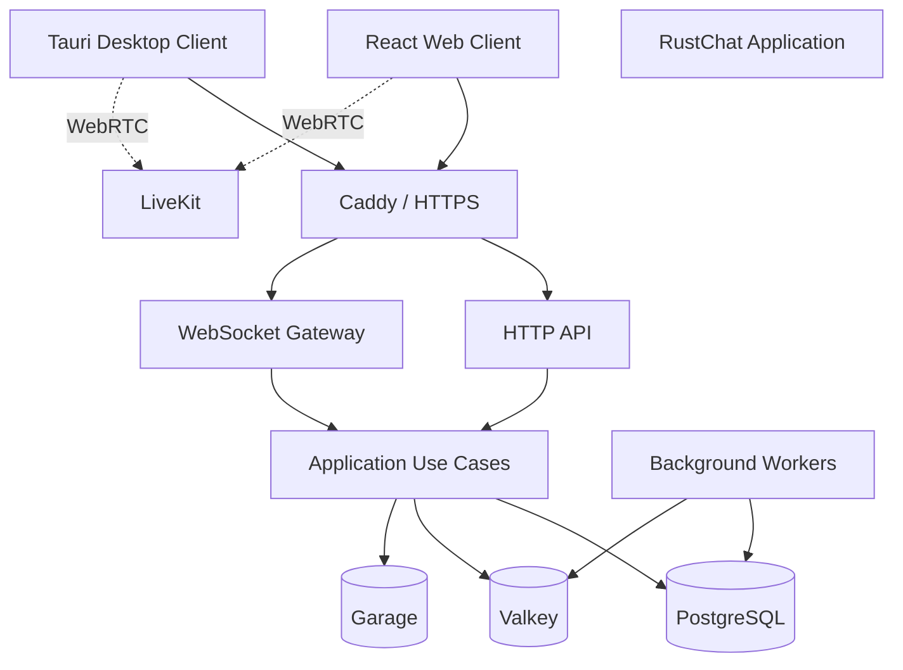

# RustChat Architecture

## 1. Purpose and status

This document describes the intended high-level architecture of RustChat. The project is in early implementation (Phase 1): the workspace layering and the accounts, sessions and rate-limiting slice exist, while everything else here is still intended design. Verify implementation details against the code.

RustChat is a self-hostable real-time communication platform with a Rust backend and a shared React frontend for web and desktop.

## 2. Architectural goals

- Clear separation of business rules, application workflows and infrastructure.
- Security enforced at trusted backend boundaries.
- Reliable message persistence and realtime delivery.
- Self-hosting with no mandatory paid SaaS dependency.
- Efficient memory, CPU, database and network usage.
- Testable modules and explicit communication contracts.
- A path to horizontal scaling without premature distributed-system complexity.

## 3. High-level system



The RustChat application initially runs as a modular monolith. HTTP handling, WebSocket handling, application services and background workers may be separate runtime tasks or processes, but they share one codebase and domain model.

## 4. Technology choices

| Area | Planned choice |
|---|---|
| Backend language | Rust |
| Async runtime | Tokio |
| HTTP framework | Axum |
| Database access | SQLx |
| Primary database | PostgreSQL |
| Cache / ephemeral coordination | Valkey |
| Realtime client transport | WebSocket |
| Web frontend | React + TypeScript + Vite |
| Desktop wrapper | Tauri 2 |
| UI styling | Tailwind CSS + shadcn/ui |
| Server state | TanStack Query |
| Local UI state | Zustand |
| Object storage | Garage (S3-compatible) |
| Voice/media | Self-hosted LiveKit |
| Reverse proxy | Caddy |
| Deployment | Docker Engine + Docker Compose |

These are proposed choices, not a substitute for checking current compatibility, security, maintenance and licences before adoption.

## 5. Backend architecture

Use Clean Architecture and domain-oriented modules.

```text
backend/
├── apps/
│   └── server/
│       └── src/
│           ├── main.rs
│           ├── bootstrap.rs
│           ├── config.rs
│           └── shutdown.rs
├── crates/
│   ├── domain/
│   │   ├── identity/
│   │   ├── messaging/
│   │   ├── conversations/
│   │   ├── communities/
│   │   ├── channels/
│   │   ├── permissions/
│   │   ├── attachments/
│   │   └── voice/
│   ├── application/
│   ├── infrastructure/
│   │   ├── postgres/
│   │   ├── valkey/
│   │   ├── object_storage/
│   │   ├── event_delivery/
│   │   └── livekit/
│   ├── interfaces/
│   │   ├── http/
│   │   ├── websocket/
│   │   └── protocol/
│   └── shared/
├── migrations/
└── tests/
```

**Current state:** the workspace has `crates/domain`, `crates/application`, `crates/infrastructure` and `crates/http` (the HTTP part of `interfaces`), plus `apps/server` for bootstrap. Domain modules are flat files inside `domain` until there is enough code to justify the per-area directories shown above. Only the identity area exists. `crates/websocket`, `protocol` and `shared` have not been created.

### Dependency rules

1. Domain contains entities, value objects, invariants and domain rules. It must not depend on Axum, SQLx, Valkey or LiveKit.
2. Application coordinates use cases and defines ports/interfaces required from external systems.
3. Infrastructure implements those ports using databases, caches, storage and external protocols.
4. Interface adapters translate HTTP and WebSocket input/output to application operations.
5. Bootstrap constructs and wires concrete implementations.

Keep boundaries useful and enforceable. Do not create abstractions without a clear reason.

## 6. Frontend architecture

Use one shared React + TypeScript application for web and desktop.

```text
frontend/
├── apps/
│   ├── web/
│   │   └── src/
│   │       ├── app/
│   │       ├── layouts/
│   │       ├── routes/
│   │       └── styles/
│   └── desktop/
│       └── src-tauri/
└── packages/
    ├── ui/
    ├── features/
    │   ├── auth/
    │   ├── messaging/
    │   ├── conversations/
    │   ├── communities/
    │   ├── channels/
    │   ├── attachments/
    │   ├── voice/
    │   └── settings/
    ├── api-client/
    ├── realtime-client/
    ├── crypto/
    ├── state/
    ├── shared/
    └── test-utils/
```

Create feature modules as they are implemented; avoid empty placeholder packages.

### Frontend state boundaries

- TanStack Query: remote/server state such as messages, channels and members.
- Zustand: local UI state such as selected panels and open dialogs.
- Realtime client: WebSocket connection lifecycle and incoming event handling.
- Zod: client-side input and response validation where useful.

The frontend is not a security boundary. The backend must independently validate and authorize every operation.

## 7. Communication model

- REST/HTTP for resource operations, queries and commands.
- WebSockets for server-pushed events and realtime interaction.
- Direct client-to-object-storage uploads using short-lived authorization where supported.
- WebRTC clients connect to LiveKit for voice media; RustChat authorizes room access.

The detailed contracts belong in `API_AND_REALTIME.md`.

## 8. Reliable messaging

A message send should follow this conceptual sequence:

1. Client creates a UUIDv7 client message identifier.
2. Server authenticates the sender and checks conversation access.
3. Server validates the request and idempotency key.
4. A database transaction allocates a conversation sequence, inserts the message and inserts an outbox event.
5. A worker publishes committed outbox events.
6. Realtime infrastructure distributes events to connected gateways.
7. Gateways deliver events to authorized clients.
8. Clients deduplicate events and synchronize from their last acknowledged cursor after reconnecting.

Use at-least-once delivery with idempotent processing. Do not claim exactly-once network delivery.

Valkey Pub/Sub may be used for initial ephemeral distribution, but it is not durable storage. The database and outbox remain the recovery source. Consider a durable broker only when actual deployment requirements justify it.

## 9. Data and infrastructure

- PostgreSQL is the source of truth for persistent application data.
- Valkey is for cache, ephemeral presence and coordination; not permanent message history.
- Garage (accessed through its S3-compatible API) stores attachments and objects outside application memory.
- LiveKit provides voice/media infrastructure; RustChat remains responsible for authorization and issuing short-lived room credentials.
- Caddy terminates HTTPS and routes HTTP/WebSocket traffic.
- Docker Compose provides an approachable self-hosted deployment.

Keep databases, caches and internal service ports private by default.

## 10. Performance principles

- Bound queues, channels, request sizes, concurrency and caches.
- Apply backpressure for slow WebSocket clients.
- Stream uploads and downloads; avoid whole-file buffering.
- Use cursor pagination and query-driven indexes.
- Avoid N+1 queries and unnecessarily long transactions.
- Use shared ownership carefully; avoid unnecessary cloning and allocation.
- Virtualize long frontend message lists when needed.
- Measure before optimizing.

Track latency percentiles, memory per connection, allocation behavior, database pool usage, CPU, event backlog and long-running stability.

## 11. Scaling strategy

**Initial:** one RustChat deployment with PostgreSQL, Valkey, object storage and LiveKit.

**Growth:** multiple API/WebSocket instances, shared persistence and coordination, separate worker processes if needed.

**Later:** add durable event infrastructure or isolate components only when measurements and operational requirements justify it.

Do not begin with microservices, Kubernetes, sharding or a custom media server.

## 12. Related documents

- [Database](DATABASE.md)
- [API and realtime protocol](API_AND_REALTIME.md)
- [Security](SECURITY.md)
