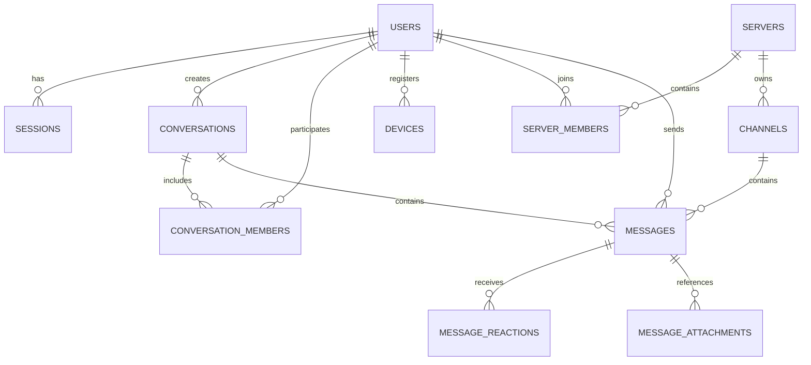

# RustChat Database Design

## 1. Purpose and status

This document records database conventions and the current PostgreSQL schema. The migrations under `backend/migrations/` are authoritative; planned entities are labeled separately below.

PostgreSQL is the primary source of truth for implemented identity, conversation, message and community data.

## 2. Design principles

- Persistent business data belongs in PostgreSQL.
- Use foreign keys and database constraints to enforce important invariants.
- Use transactions for operations that must succeed or fail together.
- Store timestamps in UTC using an appropriate timestamp type.
- Use cursor-based pagination for large or growing collections.
- Add indexes based on real query patterns and verify them with `EXPLAIN ANALYZE`.
- Keep migrations versioned and test both fresh installation and upgrade paths.
- Do not introduce sharding or partitioning before evidence requires it.

## 3. Identifier conventions

Use UUIDv7 for suitable primary identifiers, including users, conversations, messages, channels and communities.

Important qualifications:

- UUIDs are identifiers, not authorization credentials.
- UUIDv7 embeds approximate creation-time information; consider this metadata exposure where relevant.
- UUIDv7 does not replace explicit ordering within a conversation.
- Use a per-conversation or per-channel sequence number when ordered message synchronization is required.
- Generate client message IDs before submission so retries can be recognized.

## 4. Initial logical entities

| Area | Candidate tables |
|---|---|
| Identity | `users`, `user_profiles`, `sessions`, `devices` |
| Communities | `servers`, `server_members`, `roles` |
| Channels | `channels`, `channel_members`, `role_permissions` |
| Conversations | `conversations`, `conversation_members` |
| Messaging | `messages`, `message_reactions`, `message_attachments` |
| Synchronization | `read_cursors`, `outbox_events` |
| Encryption (later) | `device_keys`, `key_packages`, `encrypted_key_envelopes` |
| Administration | `server_settings`, `audit_logs` |

This is a starting inventory. Do not create every table before its feature is implemented and its requirements are understood.

### Implemented schema

The implemented tables are described below (`backend/migrations/0001_identity.sql` through `0020_instance_administration.sql`). Authentication rate-limit keys are SHA-256 digests with expiry and are shared by server instances using this database. Instance administration adds nullable account suspension timestamps and `instance_admin_audit_log`, retaining suspension and restoration actions with actor and target references. Basic profiles include an editable display name and bio. Avatars and attachments remain planned.

**`users`**

| Column | Type | Notes |
|---|---|---|
| `id` | `uuid` PK | UUIDv7, generated by the application |
| `username` | `text` NOT NULL | Stored normalized (lower-case); `UNIQUE` (`users_username_key`), so uniqueness is case-insensitive. `CHECK` enforces `^[a-z0-9_]{3,32}$` |
| `password_hash` | `text` NOT NULL | Argon2id PHC string; never plaintext |
| `created_at` | `timestamptz` NOT NULL | UTC |
| `email` | `text` NULL | Optional normalized recovery address; unique when present. Email verification remains deferred |
| `deactivated_at` | `timestamptz` NULL | Account is inactive and sessions are revoked; a successful password login clears this timestamp |
| `deleted_at` | `timestamptz` NULL | Permanent tombstone; credentials and profile are scrubbed, memberships removed, and message history retained |

**`sessions`**

| Column | Type | Notes |
|---|---|---|
| `id` | `uuid` PK | UUIDv7; exposed to the owner for session management |
| `user_id` | `uuid` NOT NULL | FK to `users(id)`, `ON DELETE CASCADE` |
| `token_digest` | `bytea` NOT NULL | SHA-256 of the cookie token; `UNIQUE`, `CHECK` length 32. The token itself is never stored |
| `created_at`, `expires_at` | `timestamptz` NOT NULL | `CHECK (expires_at > created_at)`; absolute expiry, currently 30 days |
| `revoked_at` | `timestamptz` | Set on logout or revocation; revoked rows are kept |

Indexes: the unique `token_digest` index serves per-request authentication; a partial index on `sessions (user_id) WHERE revoked_at IS NULL` serves session listing. Expired and revoked session rows are not yet purged; a cleanup job is follow-up work.

**`user_profiles`** stores one profile per account: `display_name` (maximum 64 characters), `bio` (maximum 280 characters), `discoverable`, `profile_visibility`, `presence_visible`, and `updated_at`. Account deletion scrubs the profile while retaining the profile row for historical foreign-key references. Migrations `0008_user_profiles.sql`, `0015_profile_privacy.sql`, and `0017_presence_privacy.sql` backfill profiles and apply privacy defaults.

Account deletion is a logical tombstone. User identity fields are replaced, profile fields are scrubbed, active sessions and conversation/community memberships are removed, and message rows remain attached to the stable user ID so conversation history stays intact for remaining members. Community ownership must be transferred first. Backups made before deletion can retain the pre-deletion data until their configured retention period expires; deletion from backup archives is not immediate.

`account_tokens` stores SHA-256 digests of single-use password reset tokens, with creation, expiry, and consumption timestamps. Raw reset tokens are sent only through the configured email delivery service and are never stored. A successful reset and revocation of the account's sessions happen in one transaction.

**`conversations` and `conversation_members`**

`conversations` stores a `kind` (`direct` or `group`), creator, creation time, and nullable canonical `direct_user_low` / `direct_user_high` IDs. A check constraint requires ordered, non-null user IDs for direct conversations and null pair columns for groups. The unique pair constraint makes direct creation idempotent under concurrent requests. `conversation_members` stores the membership relation with `(conversation_id, user_id)` as its primary key and cascading foreign keys. An index beginning with `user_id` supports a member's conversation list. Group size is enforced transactionally by the application under a row lock; the configured limit defaults to 100 and is bounded to 2–500.

`conversations.last_sequence` is the last allocated message sequence, starting at zero. Each send locks the conversation row, checks membership and idempotency, increments this counter, then inserts the message and outbox event in the same transaction.

**`messages`** stores the canonical plain-text message. `sequence` is unique within a conversation; `(conversation_id, sender_id, client_message_id)` is unique for retry handling. `reply_to_message_id` is nullable and constrained with `conversation_id` to a message in the same conversation. The request fingerprint is SHA-256 of the exact UTF-8 content for root messages and additionally incorporates the reply target for replies. The database also checks non-empty length, a 4,000-character ceiling and a 16,000-byte ceiling. `(conversation_id, sequence DESC)` supports history pagination.

**`message_reactions`** stores one row per `(message_id, user_id, emoji)`. Composite foreign keys ensure the message belongs to the recorded conversation and the reactor is a current conversation member. Reactions cascade with message or membership removal. Emoji values are drawn from the six built-in reactions and limited to 16 characters and 64 UTF-8 bytes. Aggregates are returned only to members who can read the conversation.

**`outbox_events`** stores creation, edit and deletion events. Each event is committed atomically with its corresponding message state. The server's single-instance poller forwards pending rows to its bounded process-local WebSocket bus, then sets `published_at`. This records dispatch to the process, not delivery to every client; clients recover gaps and recent edits from message history. The partial pending-event index supports polling. Outbox entries currently cascade when a conversation is deleted.

**`read_cursors`** stores a monotonic last-read sequence per conversation member. A composite foreign key to `conversation_members` removes a cursor when membership ends; the sequence is constrained to non-negative values and the application rejects positions beyond the conversation's latest sequence. Cursor updates are broadcast to other subscribed clients over WebSocket; reconnecting clients fetch the current values over HTTP.

**`delivery_cursors`** stores a monotonic highest-processed message sequence per conversation member. It has the same membership-scoped composite foreign key and visibility checks as read cursors. HTTP and WebSocket acknowledgements update this cursor; members can see one another's positions to display delivered state.

Messages may reference a parent message for replies. The composite foreign key binds the reply target to the same conversation, and the API validates the relationship before accepting a send. Reply target IDs are part of the idempotency fingerprint and are included in history, outbox, and realtime payloads.

**`message_mentions`** stores each distinct user mentioned by a message. The composite foreign key requires the mentioned user to be a current member of the same conversation, so mentions cannot disclose an unrelated account through a message. The application resolves `@username` tokens against current members, returns the resolved IDs in message history and realtime events, and replaces the set when a message is edited. Deleting a message or removing a member clears the corresponding mention rows.

**Communities** use `communities`, `community_members`, `community_roles`, `community_member_roles`, `community_categories`, `community_channels`, `channel_role_overrides`, and `community_invites`. Categories have stable per-community order; channel assignment is nullable and checked against the community. Deleting a category preserves its channels and makes them uncategorized. Text channels reuse conversations for membership and message history. `community_audit_log` records settings changes, member removals, ownership transfers and community deletion; the community foreign key becomes null on deletion so the record remains.

## 5. Relationships (conceptual)



A message should belong to the appropriate channel or conversation model. The final schema must make invalid combinations impossible or explicitly constrained.

## 6. Message ordering and idempotency

For a message-send operation (implemented for plain text):

- The client supplies a stable client message ID, normally UUIDv7.
- The server scopes uniqueness to the authenticated sender (and any required conversation scope).
- A unique database constraint prevents duplicate logical messages.
- Store or derive a request fingerprint so reuse of the same idempotency key with a different payload can be rejected as a conflict.
- Allocate the conversation sequence transactionally.
- Persist the message and its outbox event in the same transaction.

A retry with the same key and same request should return the original logical result. A retry with a different payload must not silently overwrite the original message.

The current key is `(conversation_id, sender_id, client_message_id)`; the fingerprint is SHA-256 of the exact content bytes. A same-key, same-content retry returns the stored message without incrementing sequence or adding an outbox event. A same-key, different-content request returns a conflict.

## 7. Transactions and outbox

Use a transactional outbox for reliable publication of events caused by committed database changes.

Conceptual transaction:

```text
BEGIN
  allocate conversation sequence
  insert message
  insert outbox event
COMMIT
```

A worker reads unpublished outbox rows, publishes them and records delivery progress. Workers must tolerate retries and duplicate publication. Consumers should be idempotent.

Do not rely on a cache Pub/Sub event as the only record that a message exists.

## 8. Query and indexing conventions

Expected access patterns include:

- Find a user by normalized login identifier.
- Find active sessions for a user/device.
- List a user's communities and channels.
- List conversation members.
- Fetch messages before/after a cursor.
- Check membership and permission efficiently.
- Find pending outbox events.

Create indexes to support measured query patterns, such as composite indexes on conversation ID and sequence, or sender ID and client message ID. Confirm actual column order and partial-index choices using representative queries and `EXPLAIN ANALYZE`.

Avoid adding indexes speculatively: indexes consume storage and increase write cost.

## 9. Pagination and synchronization

Prefer keyset/cursor pagination over large offsets.

Message synchronization should use a stable ordering cursor, such as a conversation sequence, and account for:

- reconnecting clients,
- events received more than once,
- missed realtime events,
- edits and deletions,
- membership changes and access revocation.

The client must not treat arrival time over a WebSocket as the canonical message order.

## 10. Migrations

- Use versioned, reviewed migrations.
- Never edit an already-applied migration in a way that changes its historical meaning.
- Test migrations against an empty database and a representative prior schema.
- Plan data backfills and potentially long-running operations separately.
- Use backward-compatible expand/contract changes when old and new application versions may overlap.
- Document operationally risky migrations and rollback limitations.

## 11. Data protection

- Use least-privilege database credentials.
- Do not log credentials, session secrets or private message contents.
- Back up the database and test restoration.
- Define retention and deletion behavior before release.
- Keep encryption key material out of ordinary application tables unless a reviewed protocol explicitly requires a protected representation.

## 12. Related documents

- [Architecture](ARCHITECTURE.md)
- [API and realtime protocol](API_AND_REALTIME.md)
- [Security](SECURITY.md)
