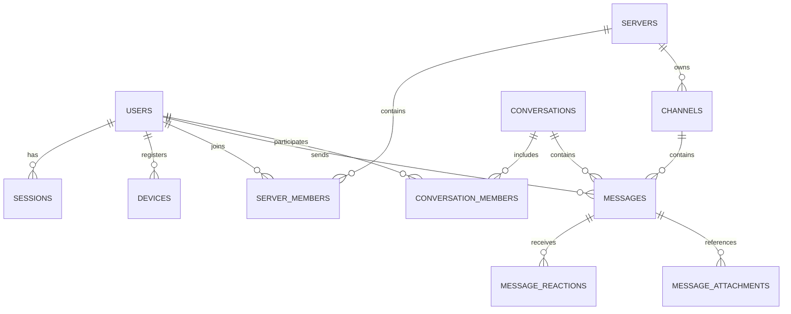

# RustChat Database Design

## 1. Purpose and status

This document defines database conventions and an initial logical model. It is not yet a final SQL schema. Table columns, nullability, constraints and indexes must be refined alongside concrete use cases and migrations.

PostgreSQL is the planned primary source of truth.

## 2. Design principles

- Persistent business data belongs in PostgreSQL.
- Use foreign keys and database constraints to enforce important invariants.
- Use transactions for operations that must succeed or fail together.
- Store timestamps in UTC using an appropriate timestamp type.
- Use cursor-based pagination for large or growing collections.
- Add indexes based on real query patterns and verify them with `EXPLAIN ANALYZE`.
- Keep migrations versioned and test both fresh installation and upgrade paths.
- Do not introduce sharding or partitioning before evidence requires it.

## 3. Identifier conventions

Use UUIDv7 for suitable primary identifiers, including users, conversations, messages, channels and communities.

Important qualifications:

- UUIDs are identifiers, not authorization credentials.
- UUIDv7 embeds approximate creation-time information; consider this metadata exposure where relevant.
- UUIDv7 does not replace explicit ordering within a conversation.
- Use a per-conversation or per-channel sequence number when ordered message synchronization is required.
- Generate client message IDs before submission so retries can be recognized.

## 4. Initial logical entities

| Area | Candidate tables |
|---|---|
| Identity | `users`, `user_profiles`, `sessions`, `devices` |
| Communities | `servers`, `server_members`, `roles` |
| Channels | `channels`, `channel_members`, `role_permissions` |
| Conversations | `conversations`, `conversation_members` |
| Messaging | `messages`, `message_reactions`, `message_attachments` |
| Synchronization | `read_cursors`, `outbox_events` |
| Encryption (later) | `device_keys`, `key_packages`, `encrypted_key_envelopes` |
| Administration | `server_settings`, `audit_logs` |

This is a starting inventory. Do not create every table before its feature is implemented and its requirements are understood.

### Implemented schema

Only the tables below exist so far (`backend/migrations/0001_identity.sql`). Everything else in the inventory above remains planned.

**`users`**

| Column | Type | Notes |
|---|---|---|
| `id` | `uuid` PK | UUIDv7, generated by the application |
| `username` | `text` NOT NULL | Stored normalized (lower-case); `UNIQUE` (`users_username_key`), so uniqueness is case-insensitive. `CHECK` enforces `^[a-z0-9_]{3,32}$` |
| `password_hash` | `text` NOT NULL | Argon2id PHC string; never plaintext |
| `created_at` | `timestamptz` NOT NULL | UTC |

**`sessions`**

| Column | Type | Notes |
|---|---|---|
| `id` | `uuid` PK | UUIDv7; exposed to the owner for session management |
| `user_id` | `uuid` NOT NULL | FK to `users(id)`, `ON DELETE CASCADE` |
| `token_digest` | `bytea` NOT NULL | SHA-256 of the cookie token; `UNIQUE`, `CHECK` length 32. The token itself is never stored |
| `created_at`, `expires_at` | `timestamptz` NOT NULL | `CHECK (expires_at > created_at)`; absolute expiry, currently 30 days |
| `revoked_at` | `timestamptz` | Set on logout or revocation; revoked rows are kept |

Indexes: the unique `token_digest` index serves per-request authentication; a partial index on `sessions (user_id) WHERE revoked_at IS NULL` serves session listing. Expired and revoked session rows are not yet purged; a cleanup job is follow-up work.

## 5. Relationships (conceptual)



A message should belong to the appropriate channel or conversation model. The final schema must make invalid combinations impossible or explicitly constrained.

## 6. Message ordering and idempotency

For a message-send operation:

- The client supplies a stable client message ID, normally UUIDv7.
- The server scopes uniqueness to the authenticated sender (and any required conversation scope).
- A unique database constraint prevents duplicate logical messages.
- Store or derive a request fingerprint so reuse of the same idempotency key with a different payload can be rejected as a conflict.
- Allocate the conversation sequence transactionally.
- Persist the message and its outbox event in the same transaction.

A retry with the same key and same request should return the original logical result. A retry with a different payload must not silently overwrite the original message.

The exact unique key and fingerprint format must be specified with the message API.

## 7. Transactions and outbox

Use a transactional outbox for reliable publication of events caused by committed database changes.

Conceptual transaction:

```text
BEGIN
  allocate conversation sequence
  insert message
  insert outbox event
COMMIT
```

A worker reads unpublished outbox rows, publishes them and records delivery progress. Workers must tolerate retries and duplicate publication. Consumers should be idempotent.

Do not rely on a cache Pub/Sub event as the only record that a message exists.

## 8. Query and indexing conventions

Expected access patterns include:

- Find a user by normalized login identifier.
- Find active sessions for a user/device.
- List a user's communities and channels.
- List conversation members.
- Fetch messages before/after a cursor.
- Check membership and permission efficiently.
- Find pending outbox events.

Create indexes to support measured query patterns, such as composite indexes on conversation ID and sequence, or sender ID and client message ID. Confirm actual column order and partial-index choices using representative queries and `EXPLAIN ANALYZE`.

Avoid adding indexes speculatively: indexes consume storage and increase write cost.

## 9. Pagination and synchronization

Prefer keyset/cursor pagination over large offsets.

Message synchronization should use a stable ordering cursor, such as a conversation sequence, and account for:

- reconnecting clients,
- events received more than once,
- missed realtime events,
- edits and deletions,
- membership changes and access revocation.

The client must not treat arrival time over a WebSocket as the canonical message order.

## 10. Migrations

- Use versioned, reviewed migrations.
- Never edit an already-applied migration in a way that changes its historical meaning.
- Test migrations against an empty database and a representative prior schema.
- Plan data backfills and potentially long-running operations separately.
- Use backward-compatible expand/contract changes when old and new application versions may overlap.
- Document operationally risky migrations and rollback limitations.

## 11. Data protection

- Use least-privilege database credentials.
- Do not log credentials, session secrets or private message contents.
- Back up the database and test restoration.
- Define retention and deletion behavior before release.
- Keep encryption key material out of ordinary application tables unless a reviewed protocol explicitly requires a protected representation.

## 12. Related documents

- [Architecture](ARCHITECTURE.md)
- [API and realtime protocol](API_AND_REALTIME.md)
- [Security](SECURITY.md)
